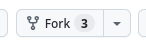
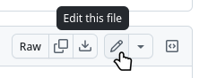
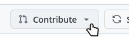

# Join the Web Dev & Design Webring

A step-by-step guide for web designers and UI designers to add your portfolio or project site to our community webring.

---

## Prerequisites

✅ **GitHub Account (Required)** – You need a free [GitHub account](https://github.com/) to create an entry yourself.

---

## Step 1: Add Webring Navigation to Your Site

Before submitting your site, ensure visitors can navigate the webring from your pages.

**Minimum requirement:** Your site must include links to:

- The **previous** site in the webring
- The **next** site in the webring
- The **main webring page** (`https://webring.webdev-webdesign.com`)

**Recommended:** Use our [navigation generator](https://webring.webdev-webdesign.com/#embed-heading) to create clean, unstyled HTML navigation that can be styled to match your site's design. This tool outputs ready-to-use code with optional random-site functionality.

> 💡 **Design Tip:** Place navigation in a visible location (header, footer, or sidebar) and style it to complement your site's aesthetic. The 88×31 pixel web badge format is a web tradition – feel free to design your own!

---

## Step 2: Fork the Repository

1. Log in to your GitHub account
2. Navigate to the [webring-webdev-webdesign repository](https://github.com/r-webdev/webring-webdev-webdesign)
3. Click the **"Fork"** button in the top-right corner



This creates a copy of the repository under your GitHub account.

---

## Step 3: Edit the Sites File

1. In your forked repository, navigate to: `src/data/sites.json`
2. Click the **pencil icon** ("Edit this file")



3. Scroll to the **end** of the file (before the final `]`)
4. Add a comma after the last existing entry (if it's not already there)
5. Add your site entry on a new line:

```json
{
  "name": "<your site name>",
  "url": "https://your-website-url.com",
  "description": "Brief description of your site or portfolio",
  "badge": "https://your-site.com/path-to-badge-88x31.png" // optional
}
```

**Field Guide:**

- `name` – Your site/portfolio name
- `url` – Full URL to your site, including `https://`
- `description` – 1-2 sentences about your work or site focus
- `badge` – URL to an 88×31 pixel image representing your site (optional)

---

## Step 4: Submit Your Site via Pull Request

1. After saving your edits, you'll see a prompt to create a Pull Request
2. Click the **"Contribute"** button



3. Use this title format: `feat: add site: <your site name>`
4. Click **"Create Pull Request"**

---

## Step 5: Wait for Review

Our maintainers will:

- ✅ Verify your webring navigation is properly implemented
- ✅ Check your site entry for completeness
- ✅ Merge your Pull Request

Once merged, your site will automatically appear in the webring rotation!

---

## Quick Checklist

Before submitting, verify you've completed:

- [ ] Added webring navigation with prev/next/main links to your site
- [ ] Added your site to `src/data/sites.json` with proper JSON formatting
- [ ] Submitted a Pull Request with the correct title
